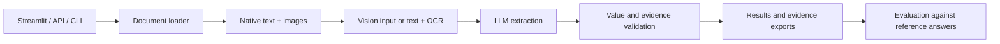

# Agreement Metadata Extraction

## Problem statement

Build an AI/ML system that extracts six fields from rental agreements across different templates:
Agreement Value, Start Date, End Date, Notice Period, Party One, and Party Two. The assignment
requires document-based extraction without a rule-based or regex approach, test-set outputs,
per-field recall and instructions to reproduce the results. A REST API is optional.

This application uses an LLM to interpret agreement clauses. It supports native documents and
scans through a FastAPI backend, Streamlit interface, and batch CLI. Reference answers are used
only for evaluation; there is no model training or fine-tuning.

## Live demo for evaluation

The application is deployed on an Azure VM.

- [Open the application](https://maanya-metadata-extraction-poc.centralindia.cloudapp.azure.com/)
- [Open Swagger API documentation](https://maanya-metadata-extraction-poc.centralindia.cloudapp.azure.com/docs)

If the model's API quota is exhausted, the application will show an error in the results.
Please retry after the provider's quota resets; availability may not return immediately.

## Dataset review and changes

The dataset has 10 train documents and 4 test documents. Comparing the actual agreements with
`train.csv` and `test.csv` revealed these issues:

| Observation | Treatment in the revised references |
| --- | --- |
| Labels for `54770958` and `54945838` were swapped relative to their scans | Reassigned each row to the correct document |
| Invalid dates, including 31 November, 31 April and 31 February | Replaced with dates supported by the stated commencement and duration |
| Surrounding spaces and some names/initials inconsistent with opening party declarations | Cleaned formatting and revised the affected reference values |
| Unreadable or unsupported answers, including notice copied from a longer contract version | Left uncertain or unsupported reference values empty |
| `24158401` appeared in both reference CSVs; `46239065` had no reference row | Consolidated the duplicate; kept the unlabelled document unscored |

Original documents and CSVs remain unchanged. Revisions are stored separately in
[data/results_corrected.xlsx](data/results_corrected.xlsx). The complete correction log,
evidence and judgement calls are in [Dataset notes](data/DATASET_NOTES.md).

### Why renewal notice became termination notice

This was a conscious decision after reviewing the CSV answers against the actual clauses.
Explicit renewal-notice periods were uncommon; most supplied answers described termination
or vacating notice. Other answers referred to exceptional notices for damage, breach or eviction.
The original notice column therefore mixed different meanings.

For example, `47854715` specifies two months for termination and one month for renewal, but
its original answer is 60 days. In `228094620`, the labelled 30 days concerns intentional damage.
We treated this mixed definition as a reference-data inconsistency and standardized the
application and revised workbook around **Termination Notice (Days)**: ordinary notice to end
the tenancy or vacate, excluding renewal deadlines and exceptional breach/eviction clauses.

This is a documented interpretation of the assignment's **Renewal Notice (Days)** field;
the two concepts are distinct. The original header is still accepted for evaluation.
See [notice examples and corrections](data/DATASET_NOTES.md#notice-interpretation).

## Implemented solution

The loader prepares text and images for a vision model, or native text plus local OCR for a
text-only model. The LLM returns structured values, source quotes, and explanations, which
Python validates before export. Field extraction does not use regex or document templates.

### Architecture



### Features and capabilities

- Accepts **DOCX, PDF, PNG, JPG, and JPEG**; one document produces one result row.
- Reads DOCX text, tables, headers/footers and embedded images; extracts PDF text and renders scans.
- Uses Gemini or an OpenAI-compatible Chat Completions endpoint. Other protocols need an adapter.
- Offers previews, searchable results, source evidence and a separate missing/ambiguous-fields table.
- Exports Extracted Metadata CSV, evidence JSON and an Excel evaluation report.
- Reuses valid cached results; changes to processing settings invalidate reuse.
- Supports three credential slots, bounded retries and safe error logging.

### Field interpretation and limits

| Field | Meaning |
| --- | --- |
| Agreement Value | Monthly rent, excluding deposits, advances and incidental charges |
| Start Date | Effective commencement, rather than signature date |
| End Date | Explicit expiry, or an inclusive end date derived from a clear start and calendar duration |
| Termination Notice (Days) | Ordinary termination/vacating notice; notice months are converted to 30 days each |
| Party One | Contracting owner/lessor, including joint owners or a company |
| Party Two | Contracting tenant/lessee, including joint tenants or a company |

Missing or ambiguous values stay empty. Dates use `DD.MM.YYYY`; rent is a plain decimal
and notice is an integer number of days. Names retain meaningful spelling, initials, and joint parties.

Defaults: **20 MB per file, 20 files per batch, 150,000 text characters, 40 image sections
and 40 PDF pages**. Oversized inputs are rejected without truncation. Locked PDFs and unsupported
DOCX content need unlocking or conversion; configurable limits are in [.env.example](.env.example).

Text quotes are checked against their sources; unverifiable evidence is rejected before export.
Image evidence needs visual inspection. OCR errors, conflicting clauses and model mistakes
remain possible.

## Why this solution was chosen

The small dataset has varied layouts and scans. Direct multimodal extraction keeps clauses
in context, distinguishes rent from deposits and termination from renewal, and provides evidence
without requiring task-specific training.

The following approaches were considered when choosing the solution:

| Approach considered | Where it helps | Decision for this assignment |
| --- | --- | --- |
| Templates / regex | Repeated, fixed document layouts | Excluded by the assignment and brittle across templates |
| Fine-tuned NER or document models | Repeated extraction tasks with representative labelled data | Too little data here to train and demonstrate reliable task-specific performance |
| OCR + text LLM | Text-only providers and scanned inputs | Implemented as a fallback; OCR can damage amounts, dates, and initials |
| Multimodal LLM | Native text and scans with varying layouts | Selected as the primary approach; requires available provider capacity and local validation |
| Vector RAG | Finding relevant content in large documents or collections | A scaling option for longer documents; the current documents are small fit and within the input limits, so retrieval would add unnecessary complexity. |

## Installation and setup

Requires **Python 3.12+**; Python 3.13 is recommended for the pinned Windows environment.
Run from the project root in PowerShell:

```powershell
py -3.13 -m venv .venv
.\.venv\Scripts\python.exe -m pip install -r requirements.txt
.\.venv\Scripts\python.exe -m pip install --no-deps -e .
if (-not (Test-Path .env)) { Copy-Item .env.example .env }
```

Enter your API key locally in `.env`.

| Setting | Configure |
| --- | --- |
| `LLM_PROVIDER`, `LLM_MODEL` | Provider and model; Gemini Flash is the default |
| `GEMINI_API_KEY` | Gemini credential; `_2` and `_3` are optional backup slots |
| `MODEL_SUPPORTS_VISION` | `true` for vision models; `false` for text-only models |
| `IMAGE_INPUT` | Keep `auto` to route according to model capability |
| `LLM_BASE_URL`, `LLM_API_KEY` | Required when `LLM_PROVIDER=openai-compatible` |

Text-only models automatically use RapidOCR for image content. Install its optional dependencies:

```powershell
.\.venv\Scripts\python.exe -m pip install -e ".[ocr-fast]"
```

PaddleOCR is also available through `requirements-ocr.txt` and `OCR_MODE=paddle`.
Restart the API and frontend after configuration changes. Backup keys need projects with
available quota; replacing a key does not reset its project's limits.

## Running the application

Start the API and Streamlit in separate terminals:

```powershell
.\.venv\Scripts\python.exe -m uvicorn metadata_extraction.api:app --host 127.0.0.1 --port 8000
```

```powershell
.\.venv\Scripts\python.exe -m streamlit run frontend/app.py --server.address 127.0.0.1 --server.port 8501
```

Open **http://127.0.0.1:8501**. Upload agreements, select **Extract details**, and inspect
**Results** and **Sources**, then choose reference answers in **Evaluation**.

### REST API

Open **http://127.0.0.1:8000/docs** for endpoint forms and response schemas.
`POST /extract` accepts one file, `/extract-batch` accepts multiple files, and `/evaluate`
compares saved results with reference answers. `/health` checks local configuration without a model call.

```powershell
curl.exe -X POST "http://127.0.0.1:8000/extract?debug=true" -F "file=@data/test/156155545-Rental-Agreement-Kns-Home.pdf.docx"
```

### Reproducing the dataset run

The following commands assume `DATA_DIR=data` and `OUTPUT_DIR=outputs`:

```powershell
.\.venv\Scripts\python.exe scripts/run_and_evaluate.py --clear-cache
.\.venv\Scripts\python.exe scripts/report_submission.py
```

The first saves extractions, evidence, original-reference reports and timings in `outputs/`.
The second updates the README tables against both reference versions without model calls.
Failed runs remain incomplete; retry without `--clear-cache` to reuse valid results.

## Evaluation process and metrics

Use **data/results_corrected.xlsx** for the revised references. To compare with the supplied
answers, evaluate `train.csv` or `test.csv` separately; selecting original and revised files
together can produce conflicting rows. Evaluation never sends reference answers to the model.

Streamlit sends the IDs of all documents in the uploaded run. Only matching reference rows
are scored. Failed/skipped documents with references count as incorrect; documents without
references are unscored. The corrected workbook covers 13 of the 14 documents.

Per-field recall is **Correct / (Correct + Incorrect)**. All three scores share the same denominator:

| Metric | What counts as correct |
| --- | --- |
| **Strict recall - primary assignment metric** | Literal equality, including case, spaces and punctuation |
| **Normalized recall** | Strict matches plus equality after formatting cleanup |
| **Tolerant recall** | Normalized matches plus guarded fuzzy matches for names only |

Normalization handles case, spaces, personal titles, and formatting punctuation in names,
and valid numeric/date representations. Meaningful initials, digits, joint-party separators,
company markers and symbols remain significant; `SRI` is retained conservatively.

Fuzzy names require **over 97% similarity**, at most one changed component, **85% or higher
similarity within that component**, and no identity conflicts. Other similarities above 90%
require review without credit. Rent, dates, and notice periods never match fuzzily.

Two empty values match only when an extracted row exists. Invalid reference values are flagged;
only literal equality can give them credit. No labelled run documents means N/A.

Excel evaluation reports contain **Summary** and **Comparisons**, including the extracted
value, reference value, match outcomes, and reasons. To generate the corrected test report:

```powershell
.\.venv\Scripts\python.exe -m metadata_extraction.cli evaluate --labels data/results_corrected.xlsx --predictions outputs/test_predictions.csv --records outputs/test_predictions.records.json --output-dir outputs/test_corrected_evaluation
```

Keep `--records`: a CSV of successful answers alone cannot identify failed uploads. Without
that manifest, CLI evaluation scores all supplied reference rows. The notice metric follows
the termination interpretation documented above.

## Test-document results

The test set consists of the four agreements in `data/test/`. These are separate from the
software tests. Original and corrected recall must use the same saved extractions.
The documents and labels were inspected during development, so this is not a blind benchmark.

**4/4 test documents extracted.** Results below use the saved Streamlit downloads:

- [Extracted metadata](outputs/Extracted%20Metadata%20Test%20Docs.csv)
- [Missing or ambiguous values](outputs/MissingAmbiguous%20Values%20Test%20Docs.csv)
- [Evaluation report against corrected references](outputs/Evaluation%20Report%20Test%20Docs.xlsx)

Document IDs below are the numeric filename prefixes. A blank notice means the agreement
does not state an ordinary termination period.

| Document | Monthly rent | Start | End | Notice (days) | Party One | Party Two |
| --- | --- | --- | --- | --- | --- | --- |
| 24158401 | 12000 | 01.04.2008 | 31.03.2009 | 60 | Hanumaiah | Vishal Bhardwaj |
| 95980236 | 9000 | 01.04.2010 | 28.02.2011 | 30 | S.Sakunthala | V.V.Ravi Kian |
| 156155545 | 12000 | 15.12.2012 | 14.11.2013 | 30 | V.K.NATARAJ | SRI VYSHNAVI DAIRY SPECIALITIES Private Ltd. |
| 228094620 | 15000 | 07.07.2013 | 06.06.2014 | | KAPIL MEHROTRA | B.Kishore |

### Recall against corrected references

The supplied Excel report was checked against the extracted CSV and `results_corrected.xlsx`.
Each field has four scored documents; overall recall pools all 24 field comparisons.

| Field | Strict recall | Normalized recall | Tolerant recall |
| --- | --- | --- | --- |
| Agreement Value | 100% | 100% | 100% |
| Start Date | 100% | 100% | 100% |
| End Date | 100% | 100% | 100% |
| Termination Notice (Days) | 100% | 100% | 100% |
| Party One | 100% | 100% | 100% |
| Party Two | 50% | 75% | 75% |
| **Overall** | **91.67% (22/24)** | **95.83% (23/24)** | **95.83% (23/24)** |

The missing notice in `228094620` matches the empty corrected reference. For names,
`B.Kishore` matches `.B.Kishore` after punctuation cleanup. The additional `SRI` in
`156155545` remains a review case and receives no credit because company-name components
are preserved. No fuzzy match added credit in this test run.

### Recall against original references

These scores were calculated from the same extracted CSV against the unchanged `test.csv`,
using the current evaluator without another model call.

| Field | Strict recall | Normalized recall | Tolerant recall |
| --- | --- | --- | --- |
| Agreement Value | 100% | 100% | 100% |
| Start Date | 100% | 100% | 100% |
| End Date | 75% | 75% | 75% |
| Notice (original Renewal Notice column) | 75% | 75% | 75% |
| Party One | 0% | 100% | 100% |
| Party Two | 25% | 75% | 75% |
| **Overall** | **62.50% (15/24)** | **87.50% (21/24)** | **87.50% (21/24)** |

Formatting differences reduce strict name recall against the original CSV. Its end-date
and notice inconsistencies also reduce recall; see [Dataset notes](data/DATASET_NOTES.md).
The downloads do not include evidence records or run timing, so those details are not reported.

### Verification and submission

```powershell
.\.venv\Scripts\python.exe -B -m pytest -p no:cacheprovider -q
.\.venv\Scripts\python.exe -B -m ruff check --no-cache src frontend scripts tests
.\.venv\Scripts\python.exe scripts/build_submission.py --final
```

Tests cover ingestion, provider routing, OCR, evidence, caching, evaluation, UI and packaging
without live model calls. Final ZIP packaging requires the complete batch-run outputs,
including evidence/run manifests and generated README metrics; the three Streamlit downloads
above do not replace those files. It creates `outputs/submission_final.zip`, excluding secrets
and runtime caches. The `outputs/` folder is no longer ignored by Git; include it with `git add outputs`.

## Scaling to longer documents

### Progressive extraction in three-page batches

A future mode could send the first three PDF pages, validate the extracted fields, then request
the next three pages when values are missing or ambiguous. Each batch would retain evidence
and reconcile new clauses with earlier findings. Batch size would be configurable.

Stopping once every field is found could reduce input size, but may miss later amendments or
contradictions. Compare recall, conflict detection, request count, latency and cost before
adopting early stopping. DOCX needs rendering or section-based batching; stitched images need
page segmentation. **This is proposed, not implemented**; the current flow reads the complete document.

### Retrieval for very long or related documents

| Option | When to consider it |
| --- | --- |
| **Vectorless RAG / [PageIndex](https://github.com/VectifyAI/PageIndex)** | Long, structured agreements: build a page/section tree and use reasoning to navigate to relevant clauses, then extract from the original evidence |
| **Hybrid keyword + vector retrieval** | Large collections or weak document structure: retrieve candidate sections, expand their context and check clause coverage |
| **[GraphRAG](https://microsoft.github.io/graphrag/index/overview/)** | Related agreements, amendments and schedules where entity relationships and clause precedence matter |

These future options need testing against the full-document baseline on a larger held-out set. They have been proposed for a different dataset, where documents are much longer and text-heavy with related information.
